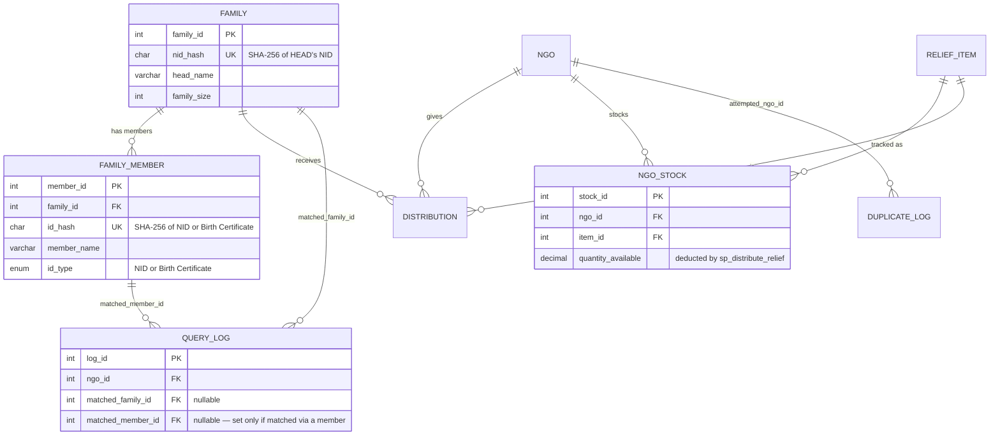
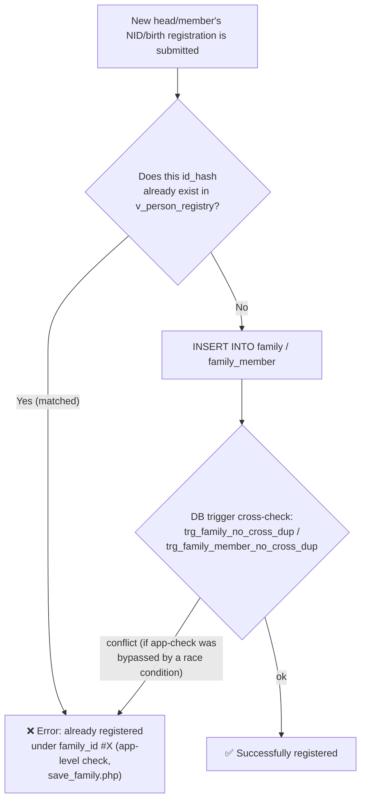
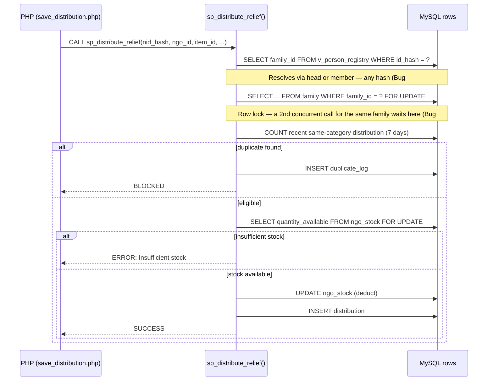

# ReliefX v3.0 — AI-Enhanced Disaster Relief & Fair Allocation System

[](https://www.php.net/)
[](https://www.mysql.com/)
[](https://fastapi.tiangolo.com/)
[](https://www.python.org/)
[](LICENSE)

**🔴 Live Demo:** https://reliefx.stratifyxglobal.com/  
**🤖 AI Microservice Docs:** http://127.0.0.1:8001/docs  

---

A modern, production-ready disaster relief management system combining a robust **PHP/MySQL Monolith** for secure relief distribution and privacy-preserving identity verification with a **Python FastAPI Microservice** for flood prediction, spatial clustering, and automated citizen rescue triage.

## 0. Problem Definition, Stakeholders & USP (DBMS guideline — Component A)

**Problem:** Two recurring challenges plague post-flood humanitarian operations in Bangladesh:
1. **Inequitable Distribution & Duplication:** The same family receives identical relief supplies multiple times from different NGOs within days, while remote neighboring families receive nothing.
2. **Privacy & Identity Leakage:** Sensitive personally identifiable information (NID, birth certificates) is transcribed into open physical registers, creating severe identity theft risks.

**ReliefX** solves both problems through multi-layered database guarantees (triggers, stored procedures, constraints) coupled with real-time geospatial intelligence.

**Stakeholders / System Users:**
- **District Relief Officer (Admin):** Oversees fairness metrics across upazilas, monitors live flood risk alerts, and manages NGO distribution queues.
- **NGO Field Operator (`ngo_operator`):** Verifies beneficiary eligibility, records distributions, and manages physical warehouse inventories.
- **Affected Citizens / Beneficiaries:** Transmit emergency SOS signals via the public portal or chat with the AI Helpline assistant in Bengali or English.

**USP (Unique Selling Points):**
1. **Zero Plaintext NID Storage:** NIDs are irreversibly hashed using salted SHA-256 (`nid_hash`) before persisting to disk.
2. **7-Day Category-Based Duplicate Shield:** Enforced at both the database trigger level and within the `sp_distribute_relief` stored procedure (defense-in-depth).
3. **Unicode-Aware Bengali Fuzzy Matching:** Custom `mb_levenshtein()` algorithm handles phonetic and orthographic variations in Bengali names.
4. **Population-Proportional Fairness Dashboard:** Dynamically balances relief allocations relative to population density using the `v_area_fairness` view.
5. **AI Rescue Clustering & Geo-Urgency (v3.0):** Real-time spatial clustering (DBSCAN 50m radius) groups stranded victims into actionable tactical nodes for armed forces and rescue teams.

---

## 1. Setup & Installation

### Option A: Using XAMPP (Apache + MySQL)

1. Copy the `relief_system` directory into your XAMPP web root:
   - Windows: `C:\xampp\htdocs\relief_system\` (or directory junction: `mklink /J C:\xampp\htdocs\relief_system <path>`)
   - macOS / Linux: `/opt/lampp/htdocs/relief_system/`
2. Start **Apache** and **MySQL** from the XAMPP Control Panel.
3. Import the database schema with UTF-8 character encoding:
   - Open `http://localhost/phpmyadmin` → **Import** → select `database.sql` (charset: **utf8mb4**) → **Go**
   - Or via terminal:
     ```bash
     mysql --default-character-set=utf8mb4 -u root -p relief_db < database.sql
     ```
4. Run the one-time installer to seed initial roles, items, and demo families:
   ```
   http://localhost/relief_system/install.php
   ```
5. Launch the Python AI Microservice (see §1.3 below).
6. Open `http://localhost/relief_system/` in your browser.

---

### Option B: Using PHP Built-in Development Server (Recommended)

1. Ensure MySQL is running (e.g. MariaDB on port 3306 or 3307).
2. Configure `.env` (copy from `.env.example` if needed):
   ```ini
   DB_HOST=127.0.0.1;port=3307
   DB_NAME=relief_db
   DB_USER=root
   DB_PASS=
   NID_SALT=relief2026_secret_salt
   ```
3. Import the database schema:
   ```bash
   mysql --default-character-set=utf8mb4 -u root -P 3307 -h 127.0.0.1 -e "source database.sql"
   ```
4. Run the installer:
   ```bash
   php install.php
   ```
5. Start the PHP server on port 8000:
   ```bash
   php -S 0.0.0.0:8000 -t .
   ```
6. Access the web application at **`http://localhost:8000`**.

---

### 1.3 Running the Python AI Microservice (FastAPI)

1. Install Python prerequisites:
   ```bash
   pip install -r ai_microservice/requirements.txt
   ```
2. Start the microservice:
   ```bash
   cd ai_microservice
   python run.py
   ```
   *The launcher automatically binds to port `8001` if port `8000` is reserved by PHP/Apache.*
3. Verify interactive API documentation:
   - **Swagger UI:** `http://127.0.0.1:8001/docs`
   - **ReDoc:** `http://127.0.0.1:8001/redoc`

---

## 2. User Roles, Access Control & Responsibility Matrix (RBAC)

ReliefX implements strict **Role-Based Access Control (RBAC)** across three distinct participant tiers:

```
┌────────────────────────────────────────────────────────────────────────────────────────┐
│                                   RELIEFX SYSTEM USERS                                 │
├───────────────────────────────┬───────────────────────────────┬────────────────────────┤
│    District Relief Officer    │       NGO Field Operator      │    Affected Citizen    │
│            (Admin)            │         (ngo_operator)        │     (General Public)   │
├───────────────────────────────┼───────────────────────────────┼────────────────────────┤
│ • District-wide Governance    │ • Field Beneficiary Enrollment│ • Zero-login SOS Portal│
│ • Full Audit & Duplication Log│ • Relief Verification & Entry │ • GPS Emergency Signal │
│ • Multi-NGO Inventory Control │ • Own NGO Stock Restocking    │ • AI Helpline Chatbot  │
│ • Strategic AI Disaster Triage│ • Tailored Operational Dash   │ • Identity Protection  │
└───────────────────────────────┴───────────────────────────────┴────────────────────────┘
```

### 2.1 Role Capabilities & Access Matrix

| Feature / Page | Route | Admin (`admin`) | NGO Operator (`ngo_operator`) | Citizen (Public) |
|---|---|:---:|:---:|:---:|
| **Fairness & Operational Dashboard** | `/dashboard.php` | ✅ Full District Overview (All NGOs) | ✅ Tailored (Own NGO Metrics & Stock) | ❌ Restricted |
| **Relief Distribution Entry** | `/distribute.php` | ✅ Can select ANY NGO | 🔒 Locked to OWN NGO | ❌ Restricted |
| **Beneficiary Family Registration** | `/register_family.php` | ✅ Enrolls & views summary table | ✅ Enrolls families in field | ❌ Restricted |
| **All Families Registry** | `/family_list.php` | ✅ Full Database Access | ❌ Restricted | ❌ Restricted |
| **Duplicate & Lookup Audit Trail** | `/duplicate_log.php` | ✅ Full Security Audit Log | ❌ Restricted | ❌ Restricted |
| **NGO Warehouse Inventory** | `/stock.php` | ✅ Multi-NGO stock inspection & add | 🔒 Own NGO stock inspection & add | ❌ Restricted |
| **NGO Organization Profile** | `/profile.php` | ✅ System Admin view | ✅ Upload custom logo & contact phone | ❌ Restricted |
| **Public NGO Registration & OTP** | `/register_ngo.php` | N/A | ✅ Self-registration + 6-digit OTP | ✅ Open for NGOs |
| **Weather & Flood Early Warning Alerts** | `/weather_alerts.php` | ✅ Accessible | ✅ Accessible | 🌟 **Open Without Login** |
| **Emergency SOS Rescue Portal** | `/sos_portal.php` | ✅ Accessible | ✅ Accessible | 🌟 **Open Without Login** |
| **AI Helpline Chatbot Assistant** | Floating widget on all pages | ✅ Accessible | ✅ Accessible | 🌟 **Open Without Login** |

---

### 2.2 Seed Credentials & Demo Accounts

| Username | Password | Role | Description |
|---|---|---|---|
| `admin` | `Admin@123` | District Relief Officer | System administrator with full district oversight, fairness governance, and audit trails. |
| `asha_operator` | `Ngo@123` | Asha Foundation | Field operator for Asha Foundation (relief distributions, stock management, family enrollment). |
| `relief_operator` | `Ngo@123` | Relief Bangladesh | Field operator for Relief Bangladesh. |
| `sfv_operator` | `Ngo@123` | Save the Flood Victims | Field operator for Save the Flood Victims. |

> **Self-Registration for New NGOs:** Any authorized organization can register via `/register_ngo.php`. Upon submitting official details, a 6-digit verification code is generated/emailed and validated on `/verify_email.php` before granting `ngo_operator` privileges.

## 3. Complete File Structure

```
relief_system/
├── .env                              ← real environment variables & secrets (gitignored)
├── .env.example                       ← committed template for environment variables
├── .gitignore                          ← excludes sensitive and cache files from git
├── .htaccess                             ← blocks direct web access to sensitive dotfiles
├── Project_Report.docx                   ← comprehensive academic/DBMS project documentation
├── README.md                             ← complete system guide and technical documentation
├── database.sql                         ← schema + triggers + procedures + views + seed data (UTF-8)
├── queries_for_report.sql                ← analytic SQL queries for DBMS reporting
├── roles_optional.sql                    ← optional database-level user privilege grants
├── er_diagram.png                        ← high-resolution Entity-Relationship diagram
├── config.php                            ← DB PDO connection, hashNID(), mb_levenshtein(), env loader
├── install.php                           ← one-time account setup script (seeds admin & operators)
├── index.php                             ← landing page and login portal
├── logout.php                            ← terminates session and redirects to login
├── distribute.php                        ← core relief distribution workflow & live duplicate check
├── register_family.php                   ← beneficiary registration with fuzzy match & cross-check
├── family_list.php                       ← admin-only: complete registry of all enrolled families
├── dashboard.php                         ← admin-only: fairness gauge, NGO performance & live map
├── duplicate_log.php                     ← admin-only: audit log of blocked duplicates & lookup trail
├── stock.php                             ← NGO inventory tracking & restock management
├── weather_alerts.php                    ← public real-time hydrological & flood warning alert portal (unauthenticated)
├── sos_portal.php                        ← citizen-facing public SOS distress portal (unauthenticated)
├── register_ngo.php                      ← public self-registration for partner NGOs
├── verify_email.php                      ← 6-digit verification code entry for new NGOs
├── forgot_password.php                   ← automated email password reset workflow
├── profile.php                           ← NGO organization profile & custom logo upload
├── switch_lang.php                       ← language switcher (BN / EN) with session & cookie memory
├── ai_microservice/                      ← Python AI Microservice (FastAPI scaffolding v3.0)
│   ├── main.py                           ← FastAPI app, CORS, routes & mock AI/ML models
│   ├── run.py                            ← smart port-conflict detector and Uvicorn launcher
│   ├── requirements.txt                  ← Python dependencies (fastapi, uvicorn, pydantic)
│   └── README.md                         ← dedicated microservice architecture documentation
├── api/                                  ← AJAX endpoints (CSRF-protected & session-verified)
│   ├── get_weather_alerts.php            ← real-time river stage, danger mark & rainfall station feed (public)
│   ├── check_duplicate.php               ← live family & 7-day category duplicate check
│   ├── fuzzy_check.php                   ← Unicode-aware Levenshtein duplicate name detector
│   ├── save_family.php                   ← family registration with cross-check identity protection
│   ├── save_distribution.php             ← atomic relief distribution caller for sp_distribute_relief
│   ├── save_distribution_point.php       ← registers new distribution points associated with an upazila
│   ├── save_ngo_profile.php              ← updates NGO contact information & logo file
│   └── save_stock.php                    ← adds inventory quantity to an NGO-item pair
├── css/
│   └── style.css                         ← responsive dark/light glassmorphic UI stylesheet + AI & SOS styling
├── js/
│   ├── app.js                            ← frontend logic, AJAX lookups, Leaflet map, AI widgets & SOS form
│   ├── auth.js                           ← authentication validations, tabs, and login helpers
│   ├── chatbot.js                        ← AI Helpline chatbot UI controller & FastAPI webhook caller
│   └── theme.js                          ← dark/light mode toggle with localStorage persistence
├── img/
│   ├── logo-icon.png                     ← circular ReliefX brand emblem & favicon
│   ├── logo-full.jpeg                    ← full ReliefX emblem and typography wordmark
│   ├── dashboard-preview.png             ← fairness dashboard UI mock preview
│   └── distribute-preview.png            ← relief entry workflow UI mock preview
└── includes/
    ├── auth.php                          ← RBAC enforcement, session authentication, CSRF protection
    ├── auth_brand.php                    ← unified layout wrapper for authentication pages
    ├── env.php                           ← lightweight .env parser without external dependencies
    ├── header.php                        ← global navigation bar, language switcher & CSRF bridge
    ├── footer.php                        ← global footer & base script inclusions
    ├── icons.php                         ← lightweight SVG icon renderer (Feather icon set)
    ├── lang.php                          ← bilingual translation engine (UI + dynamic database entities)
    ├── mailer.php                        ← SMTP email helper for verification & password reset codes
    └── PHPMailer/                        ← embedded PHPMailer library
        ├── Exception.php
        ├── PHPMailer.php
        └── SMTP.php
```

## 4. What to Demonstrate in the Viva

1. **Duplicate blocking:** Log in as `asha_operator` → on distribute.php, enter NID `1985011234501`
   (Rahim Uddin, received rice 15 days ago — outside the 7-day window, so should show as eligible now) → submit with item "Blanket" (a different category)
   → should succeed. Now submit again with the same NID + same item → 🚫 blocked, and
   an entry will appear in `duplicate_log.php` (when logged in as admin).
   (NID pattern for the 20 demo families: family #N ↔ `19850112345` + N in two digits, e.g. family #10 ↔
   `1985011234510` — any of them can be used for testing, see §7.1 Bug #6.)
2. **Fuzzy matching:** On register_family.php, try registering a name close to "Rahim Uddin" like "Rahiim Uddeen"
   → a warning modal will appear.
3. **Role-based access:** Logging in as `admin` shows the Dashboard + Duplicate Log tabs and lets you browse
   the full family list; logging in as `asha_operator` hides these and locks the NGO field on distribute.php.
4. **Fairness dashboard:** Open dashboard.php as `admin` — a gauge bar shows which area received less relative
   to its population, along with NGO Performance and Weekly Trend bar charts.
5. **Identity conflict (Version 2.0 — new):** On register_family.php, try registering a new family with an NID
   that's already registered as a member of another family (in family_member) → it immediately shows an error
   "This NID is already registered under family_id #X", and the insert is blocked. This is the core bug that was fixed —
   details in §7.
6. **Distributing relief using a member's NID (Version 2.0 — new):** On distribute.php, instead of the
   family head's NID, enter a family_member's NID/birth registration number → the family is still found correctly,
   and a note appears: "ℹ️ This NID does not belong to the family head...". Previously this showed "not_found".
7. **Stock enforcement (Version 2.0 — new):** As admin, go to `stock.php` and reduce the quantity_available
   for some NGO-Item (or leave a small quantity and try to distribute more) → distribute.php shows
   "ERROR: Insufficient stock for this NGO/item" when that amount is requested, and the distribution is not inserted.
8. **CSRF protection (Version 2.0 — new):** Try changing the `CSRF_TOKEN` variable from browser DevTools and
   calling any api/*.php endpoint → you'll get a 403 with a "session expired" message, and nothing gets inserted.
9. **Flood Risk & Prioritized Warehouse Dispatch (v3.0 — AI Microservice):** Log in as `admin` and navigate to `dashboard.php`.
   Observe the top AI widgets: the **Flood Risk Alert Card** asynchronously queries `GET /api/v1/flood-prediction` to render
   live river stage warnings, rainfall forecasts, and severity indicators. The **Geo-Urgency & Warehouse Dispatch Queue**
   renders real-time supply allocations computed from the weighted formula:
   $$\text{Urgency Index} = (0.45 \times \text{Flood Risk}) + (0.35 \times \text{SOS Density}) + (0.20 \times \text{Underserved Factor})$$
10. **Bilingual AI Helpline Chatbot (v3.0 — AI Microservice):** Click the circular AI Helpline launcher in the bottom-right
    corner of any page. Submit a prompt such as `"বাঁচাও, আমরা চিলমারী প্রাইমারি স্কুলের ছাদে আটকা!"` or `"Send rescue boat to Kurigram"`.
    The bot calls `POST /api/v1/chat/webhook`, extracts the stranded victim's name, coordinates, and landmark, and automatically
    returns a simulated **Emergency Rescue Ticket** with a unique Ticket ID and high-priority dispatch flag.
11. **Citizen Emergency SOS Portal & DBSCAN Spatial Clustering (v3.0 — Citizen Facing):**
    Open `sos_portal.php` in a private/incognito window (no login required). Click **"Use My Live Location"** to fetch GPS coordinates
    via the browser Geolocation API, check the required relief supplies (Boat, Medical, Food), and click **Transmit Emergency SOS Signal**.
    The form submits to `POST /api/v1/sos-request`, grouping the caller into a tactical 50m spatial cluster (Rescue Node) and providing immediate visual feedback with rescue dispatch coordinates and emergency hotlines (999, 1090, 16163).

## 5. Mapping to Guideline Components

| Guideline component | Where it is |
|---|---|
| Problem statement / stakeholders / USP | §0 of this file |
| ER diagram / 3NF | `er_diagram.png` (see §0.1 for how it was built) + table design in `database.sql`, mermaid ER in §7.3 |
| CREATE TABLE + constraints | `database.sql` — all PK/FK/CHECK/UNIQUE present |
| ≥20 records/table | family: 20, distribution: 28, district: 64, upazila: ~487 |
| INSERT/UPDATE/DELETE/SELECT (WHERE/GROUP BY/ORDER BY/LIMIT/HAVING)/JOIN/Aggregate (COUNT/SUM/AVG)/Subquery | used throughout the app (see the api files) + individually runnable examples in `queries_for_report.sql` |
| TRIGGER | `trg_block_duplicate`, `trg_family_no_cross_dup`, `trg_family_member_no_cross_dup` (Version 2.0) |
| PROCEDURE | `sp_distribute_relief` (Version 2.0 added transaction + row lock + stock deduction) |
| VIEW | `v_area_fairness`, `v_person_registry` (Version 2.0 — identity resolution) |
| Transaction | `START TRANSACTION`/`COMMIT`/`ROLLBACK` in `sp_distribute_relief` + PDO transactions in `api/save_family.php`, `register_ngo.php` |
| System roles/privileges (optional) | session-based role check (`includes/auth.php`) + each NGO operator restricted to their own ngo_id + CSRF token (Version 2.0); example DB-level `GRANT` statements in `roles_optional.sql` (optional, not run) |
| Investigation & Analysis (Component D) | questions D1–D3 in `queries_for_report.sql` (underserved area, category demand, severity-wise fairness) |

## 6. Key Engineering Decisions (worth writing up in the report)

- **PHP's built-in `levenshtein()` gives incorrect results on Bengali text** (it's byte-based, but Bengali characters are multi-byte UTF-8).
  So a custom `mb_levenshtein()` was written in `config.php` that compares Unicode characters instead.
- **MySQL's `SOUNDEX()` is designed for English phonetics** and doesn't give meaningful codes for Bengali names — so fuzzy matching uses
  a LIKE-based candidate filter (matching the first 2 characters) + confirmation via `mb_levenshtein()` in PHP — this is a
  good example of EP2 (performance vs. correctness trade-off, a conflicting requirement for non-Latin scripts).
- **Defense-in-depth:** the submit button is deliberately not disabled after a duplicate warning is shown — because real
  enforcement shouldn't live in client-side JS, it should live in the database's trigger and procedure. Even if the client is
  bypassed, the database will still block it.

## 7. Version 2.0 — Bug Fixes & New Features (detailed log)

This section is kept so that **we can remember for ourselves in the future why a bug happened and how it was fixed.**
Each fix has a `BUG FIX (README "Bug #X")` comment in the relevant file, so you can come back to this log while reading the code.

### 7.1 Bugs Found & Fixed

**Bug #1 — the same person could register twice (the core problem that started this whole update)**
- **Problem:** The `family` table only stores the family head's NID (`nid_hash`), while the `family_member` table stores
  the other members' NID/birth registration (`id_hash`). During registration (`api/save_family.php`), a new head's NID was
  checked only against the `family` table — not against `family_member`. As a result, someone already registered as a member
  of another family could register again as a separate family head — creating two separate relief entitlements for the same
  person. During relief distribution too (`api/check_duplicate.php`, `sp_distribute_relief`), the family was looked up only
  by the head's NID — entering a member's NID/birth registration number would show "not_found", even though that person was
  actually part of a registered family.
- **Fix:**
  1. New VIEW `v_person_registry` — unions family (head) and family_member (members) into one place,
     telling you which `family_id` an `id_hash` belongs to, and whether it's the head or a member.
  2. Two new triggers — `trg_family_no_cross_dup` (checks before inserting as head whether the NID already exists
     as a member) and `trg_family_member_no_cross_dup` (the reverse) — a hard safety net at the DB level.
  3. `api/save_family.php` now shows a friendly app-level error (including which family_id it's already under),
     so the operator understands before it even reaches the trigger. **Deliberately, no "force/override" option
     was added here** — because an identity conflict always means either a genuine duplicate or a data-entry mistake;
     the correct fix for both is to correct the earlier record, not create a new parallel identity.
  4. `api/check_duplicate.php` and `sp_distribute_relief` now resolve via `v_person_registry` — entering the head's
     or any member's NID/birth registration number correctly finds the family, and the 7-day duplicate-check
     applies to that family.
- **Test:** See README §4 items 5 and 6.

**Bug #2 — Race condition: two parallel requests could let the same family receive relief twice**
- **Problem:** In the old `sp_distribute_relief`, "SELECT COUNT(*) recent" and "INSERT INTO distribution" were two
  separate auto-committed statements with no row lock in between. If two operators submitted for the same family at
  nearly the same moment, both calls could see recent_count = 0 (because each other's INSERT wasn't committed/visible
  yet), so both would pass the duplicate-check and the family would end up receiving relief twice.
- **Fix:** The whole procedure is now wrapped in an explicit `START TRANSACTION`, and before the duplicate-check,
  `SELECT ... FROM family WHERE family_id=? FOR UPDATE` locks that family's row — so a second concurrent call for the
  same family is blocked here until the first one's COMMIT/ROLLBACK completes. The same logic applies to `ngo_stock`
  (see below), so that two parallel distributions can't push stock below zero together.
- **Test (hard to demonstrate manually, show in code review):** Show the
  `START TRANSACTION` ... `FOR UPDATE` ... `COMMIT`/`ROLLBACK` pattern inside `sp_distribute_relief` in `database.sql`.

**Bug #3 — DB password and NID salt were hardcoded directly in the code**
- **Problem:** `DB_PASS`, `NID_SALT`, etc. were written as literal strings in `config.php` — once committed to
  version control, they'd remain in history forever.
- **Fix:** `includes/env.php` (a small `.env` parser, no composer) + `.env` (the real secrets, gitignored) +
  `.env.example` (a committed template) + `.htaccess` (blocks direct browser access to dotfiles). If `.env` is
  missing, it falls back to the previous hardcoded defaults, so existing setups don't break.

**Bug #4 — the demo accounts created by `install.php` could never log in**
- **Problem:** The schema default for the `users.is_verified` column is `0`. `install.php` didn't explicitly
  set `is_verified` when creating accounts, so on a completely fresh install neither admin nor any operator could
  log in (`index.php` showed a "please verify your email first" error, even though no verification email is ever
  sent for these accounts). This bug was caught during live testing for this update.
- **Fix:** The INSERT in `install.php` now explicitly sets `is_verified = 1` — because these accounts are created
  by a trusted installer, not through `register_ngo.php`'s public self-registration flow, so email verification
  doesn't apply.

**Bug #6 — none of the 20 demo families could ever be found by NID (the most important discovery)**
- **Problem:** Caught during live testing for this update — calling `check_duplicate.php` with the documented demo
  NID from README §4 (`1985011234501`) returned "not_found", even though family_id 1 definitely exists in the
  database. The cause was traced: every `nid_hash` seeded for the 20 families in `database.sql` was actually
  **62–63 characters long, not 64** (confirmed in the DB using `CHAR_LENGTH()`) — whereas a SHA-256 hash is always
  exactly 64 hex characters. For family 1, it turned out the very last character of the correct hash was missing
  (likely a copy-paste error while pre-computing the hashes). This meant **this flagship duplicate-blocking demo
  had never worked from day one** — not a single one of the 20 could be matched with its actual NID.
- **Fix:** The correct SHA-256(NID + salt) was recomputed for the sequential demo NIDs `1985011234501` through
  `1985011234520`, and all 20 families' `nid_hash` values were replaced. Family 1's demo NID was kept unchanged
  (it was already documented in the README), and the remaining 19 were assigned new NIDs following the same
  pattern (sequential, like `phone`) — now **for any family_id, the NID can be built from the last 2 digits of
  `phone`**: family #N ↔ NID `19850112345` + N (2 digits, e.g. family #7 ↔ `1985011234507`).
- **Test:** Entering any `19850112345XX` (XX = 01–20) as the NID on distribute.php will now find the matching
  family — previously this wasn't possible at all.

**Bug #5 — expired sessions caused a 404 loop when calling `api/*.php`**
- **Problem:** `requireLogin()` sent `header('Location: index.php')` when not logged in — a *relative* path.
  This worked fine when called from a page controller (like `distribute.php`), but when called from a file like
  `api/save_family.php`, the browser resolved it as `/relief_system/api/index.php` — which doesn't exist, hence
  404. Also, sending an HTML redirect for an AJAX/fetch() call is the wrong approach in general — the frontend
  expects JSON.
- **Fix:** A new `isApiRequest()` helper in `includes/auth.php` — checks whether `/api/` appears in `SCRIPT_NAME`.
  If so, `requireLogin()`/`requireRole()` now return a clean JSON 401/403 response (with an `api_session_expired`
  key), instead of a plain HTML redirect.

### 7.2 New Features (not bugs, new additions)

- **CSRF protection** — `csrfToken()`/`requireCsrf()` in `includes/auth.php`, a session-based token. All
  state-changing APIs (`save_family`, `save_distribution`, `save_distribution_point`, `save_stock`) and the
  `register_ngo.php` form now verify the token, or return 403. Previously no form had CSRF protection.
- **NGO Stock tracking** — new table `ngo_stock` (ngo_id, item_id, quantity_available). `sp_distribute_relief`
  now deducts from stock on every successful distribution and blocks the distribution if stock is insufficient
  (previously there was no concept of stock at all — an NGO could theoretically give out an infinite quantity).
  A new `stock.php` page (admin-only) shows the current stock for every NGO-Item and lets you add to it via
  `api/save_stock.php`.
- **Dashboard charts** — `dashboard.php` now shows NGO Performance and an 8-week Weekly Trend bar chart next
  to the fairness gauge (with no external JS chart library — just CSS, so it also works in an offline viva).
- **Richer audit trail** — new columns `matched_family_id`, `matched_member_id` in the `query_log` table —
  recording which family/member each lookup matched. `duplicate_log.php` now has a new "🔍 Lookup Audit Trail"
  section showing this to the admin (previously only blocked attempts were visible, not successful lookups).

### 7.3 ER Diagram — identity- and stock-related tables



> **Note:** `v_person_registry` is a VIEW (a UNION of family + family_member), so it doesn't appear as a
> separate entity in this ER diagram — the flowchart below shows how it's used.

### 7.4 Identity Resolution Flow — during registration



### 7.5 During Relief Distribution — resolution + race-condition fix + stock check



### 7.6 Frontend Polish — logo, animations, map

- **Logo:** Two variants were made from `Logo.jpeg` — `img/logo-full.jpeg` (full, with wordmark, used on login/registration pages) and `img/logo-icon.png` (just the circular emblem, wordmark cropped out, used for the header badge + favicon).
- **CSS animations:** card/KPI fade-up entrance; gauge/bar fills now animate from 0 to their target value (`animateFillBars()` in `js/app.js`); KPI numbers count up (`animateKpiCounters()`); button hover/active states get lift+scale feedback; a floating gradient blob background on the login page.
- **🗺️ Relief Zone Map (dashboard.php):** Leaflet.js + OpenStreetMap (no API key needed) shows the 8 relief zones on a map of Bangladesh — marker color reflects the fairness ratio (red/yellow/green), marker size reflects population. Each area's lat/lng is hardcoded as a PHP array in `dashboard.php` (no new DB column was added, since these 8 areas are fixed reference data).
- **Accent color:** The logo's orange color (`--accent`) was added as the new brand accent (used for the active tab underline, `.btn-accent`, etc.).
- **Code-based email verification:** `register_ngo.php` used to send a verification link (which had to be clicked); it now sends a 6-digit code instead (via `includes/mailer.php`), and `verify_email.php` requires entering email+code to verify — direct code entry instead of a phishing-prone link-click flow.

### 7.7 Dynamic Bilingual Localization & Character Encoding Fix (Version 2.1)

- **Dynamic Entity Translation:** Previously, switching between Bengali (`বাংলা`) and English (`EN`) only translated static interface labels, while stored database values (relief items, NGO names, distribution points, relief zones, units, and family head names) remained in Bengali. Version 2.1 introduces `tEntity()` and `tCategory()` in `includes/lang.php` with an entity dictionary. When English is selected, items like `চাল (Food)` dynamically render as `Rice (Food)`, `আশা ফাউন্ডেশন` becomes `Asha Foundation`, and table records adapt to the active language.
- **Language Preference Persistence:** Language selection in `switch_lang.php` now saves to both `$_SESSION['lang']` and a long-lived browser cookie (`reliefx_lang`), ensuring language preferences persist across reloads, new tabs, and browser restarts.
- **UTF-8mb4 Character Encoding Protection:** Windows command shell redirection previously caused `database.sql` to import using ANSI/CP1252 codepages, producing Mojibake corruption on Bengali Unicode strings. The database is now strictly imported with `--default-character-set=utf8mb4` to ensure Bengali characters render in clean Hind Siliguri typography.

---

## 8. ReliefX v3.0 — Python AI Microservice (FastAPI) & Citizen Helpline

Version 3.0 upgrades the monolithic PHP/MySQL architecture into a hybrid modern system by integrating an asynchronous Python AI Microservice built with **FastAPI**.

```
┌─────────────────────────────────┐        REST JSON (CORS)       ┌─────────────────────────────────┐
│        ReliefX Frontend         │ ◄───────────────────────────► │      Python AI Microservice     │
│   PHP 8.2 + Glassmorphic UI     │                               │      FastAPI + Uvicorn 8001     │
│                                 │                               │                                 │
│  - dashboard.php (Risk & Queue) │ ──── GET /flood-prediction ─► │  - XGBoost/LSTM Mock Model      │
│  - dashboard.php (Geo Urgency)  │ ──── GET /geo-urgency ──────► │  - Urgency Index Formula Engine │
│  - chatbot.js (Helpline Widget) │ ──── POST /chat/webhook ────► │  - NLP Entity Extractor & Ticket│
│  - sos_portal.php (Citizen SOS) │ ──── POST /sos-request ─────► │  - DBSCAN Spatial Cluster Engine│
└─────────────────────────────────┘                               └─────────────────────────────────┘
                 │
                 ▼ SQL Queries
      MySQL 8.0 (Port 3307 / 3306)
```

### 8.1 Microservice Endpoints (`/api/v1`)

| Method | Endpoint | Description | Input / Parameters | Response Highlights |
|---|---|---|---|---|
| `GET` | `/api/v1/flood-prediction` | Flood severity prediction | `lat`, `lon` (query params) | `risk_level` (`Low`, `Moderate`, `Severe`, `Critical`), water level forecast, recommended action |
| `GET` | `/api/v1/geo-urgency` | Geo-urgency index & NGO dispatch list | None | `urgency_index` via `(0.45 * Flood_Risk) + (0.35 * SOS_Density) + (0.20 * Underserved_Factor)` + prioritized warehouse dispatch queue |
| `POST` | `/api/v1/chat/webhook` | Bilingual AI helpline webhook | JSON `{ message, lang, session_id }` | Conversational response, extracted `name`, `gps`, `landmark`, and simulated Emergency Rescue Ticket |
| `POST` | `/api/v1/sos-request` | Citizen SOS submission & clustering | JSON `{ name, phone, lat, lon, landmark, people_count, needs }` | Spatial clustering (simulating DBSCAN with 50m radius) into a grouped `rescue_node` |

### 8.2 Frontend UI Components Integrated

1. **Flood Risk Alert Card (`dashboard.php` & `js/app.js`):**
   - Admin-facing widget displaying real-time AI risk level badge, water level forecast, rainfall estimate, and tactical advisories across active flood zones (Chilmari, Kurigram, Rowmari, Nageshwari).
2. **Prioritized NGO Warehouse Dispatch Queue (`dashboard.php` & `js/app.js`):**
   - Renders warehouse dispatch prioritization ordered by calculated Urgency Index, including recommended supply allocation (food packets, water purification tablets, medical units).
3. **Citizen-Facing AI Helpline Chatbot (`includes/footer.php` & `js/chatbot.js`):**
   - Globally accessible floating widget available across all pages.
   - Handles bilingual queries (Bangla & English), quick SOS chips, auto-scrolling, and parses simulated emergency rescue tickets with unique Ticket IDs.
4. **Emergency SOS Rescue Portal (`sos_portal.php` & `js/app.js`):**
   - Public-facing page requiring no login or authentication.
   - Includes browser GPS auto-detection (`navigator.geolocation`), urgent needs checklist (boats, medicine, dry rations, shelter), and visual feedback rendering the assigned AI Rescue Cluster Node.

### 8.3 Launching the Microservice

```bash
# 1. Install dependencies
pip install -r ai_microservice/requirements.txt

# 2. Run the AI Microservice
cd ai_microservice
python run.py
# Microservice starts on http://127.0.0.1:8001 (or 8000 if available)
# Interactive Swagger Documentation: http://127.0.0.1:8001/docs
```

### 8.4 Verification & Testing Examples (cURL)

#### 1. Flood Risk Prediction
```bash
curl -X GET "http://127.0.0.1:8001/api/v1/flood-prediction?lat=25.7538&lon=89.6738"
```
*Response contains simulated risk level, rainfall forecast, river level in meters, and evacuation advisory.*

#### 2. Geo-Urgency Index & Warehouse Prioritization
```bash
curl -X GET "http://127.0.0.1:8001/api/v1/geo-urgency"
```
*Response contains ranked zones by urgency index and allocated food, water, and medical kits.*

#### 3. AI Helpline NLP Webhook
```bash
curl -X POST "http://127.0.0.1:8001/api/v1/chat/webhook" \
  -H "Content-Type: application/json" \
  -d '{"message": "আমি রহিম, চিলমারী স্কুলের ছাদে ৫ জন সহ আটকে আছি। জিপিএস 25.56, 89.67", "lang": "bn"}'
```
*Extracts name, GPS, landmark, and generates an emergency rescue ticket.*

#### 4. Citizen SOS Request & DBSCAN Spatial Clustering
```bash
curl -X POST "http://127.0.0.1:8001/api/v1/sos-request" \
  -H "Content-Type: application/json" \
  -d '{"name": "করিম মিয়া", "phone": "01711000000", "lat": 25.5612, "lon": 89.6723, "landmark": "নদীর বাঁধের সংলগ্ন", "people_count": 4, "needs": ["boat", "medical"]}'
```
*Groups the request into a tactical 50m Rescue Node cluster with assigned boat teams.*


